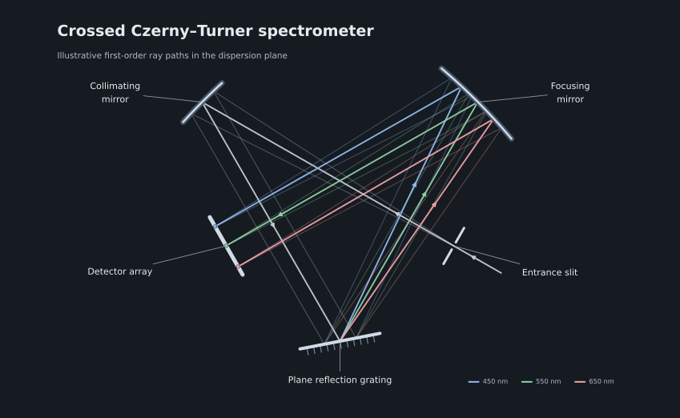
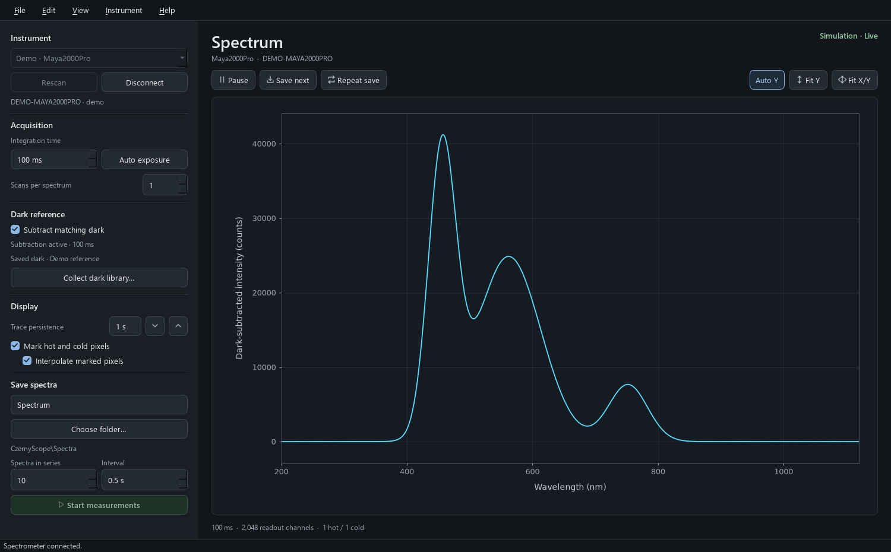

# CzernyScope

Windows desktop acquisition for the Ocean Optics Maya2000 Pro and USB650. The same app can open from LightKeeper 0.4.3. The desktop UI uses PySide6 and Matplotlib.

## Why CzernyScope?

**Czerny** comes from the Czerny–Turner optical layout. The Maya2000 Pro uses a symmetrical crossed version of this design. **Scope** refers to the app's live spectrum display. [Czerny and Turner (1930)](https://link.springer.com/article/10.1007/BF01340206) · [Maya2000 Pro operating instructions, p. 2](https://www.oceanoptics.com/wp-content/uploads/2024/12/Maya2000ProSeries-Operating-Instructions.pdf#page=10)

The entrance slit is placed near the first concave mirror’s focus in the dispersion plane. Light from the slit diverges to the mirror, which reflects it toward the grating as a nearly parallel bundle. A second concave mirror focuses the diffracted bundles onto the detector array. In the crossed layout, the slit-to-mirror path crosses the mirror-to-detector path.



*Generic example in the dispersion plane. The grating has 600 grooves/mm and the first-order rays show 450, 550, and 650 nm.*

### Why the grating separates wavelengths

Each illuminated groove scatters the incident field. To compare two adjacent grooves, measure both angles from the surface normal on the illuminated side to ray arms pointing away from the grating. Positive angles turn clockwise in the diagram.

| Symbol | Definition |
| --- | --- |
| $`d`$ | Distance between adjacent grating grooves, measured perpendicular to the grooves. |
| $`\alpha`$ | Signed incidence angle from the normal to the arm pointing toward the collimating mirror. |
| $`\beta`$ | Signed diffraction angle from the normal to the arm pointing toward the focusing mirror. |
| $`\lambda`$ | Wavelength of the light in the surrounding medium, which is air in the example. |
| $`\Delta\ell`$ | Signed path-length difference between the contributions from adjacent grooves. |
| $`\Delta\phi`$ | Corresponding phase difference in radians. |
| $`m`$ | Signed integer diffraction order. |

Use the same length unit for $`d`$, $`\lambda`$, and $`\Delta\ell`$. Projecting one groove spacing onto both ray arms gives

```math
\Delta\ell = d(\sin\alpha + \sin\beta)
```

A full cycle is $`2\pi`$ radians, so the phase difference is $`\Delta\phi = 2\pi\Delta\ell/\lambda`$. The contributions reinforce when $`\Delta\phi = 2\pi m`$, which gives the grating equation.

```math
m\lambda = d(\sin\alpha + \sin\beta)
```

In zeroth order, $`m=0`$ gives $`\beta=-\alpha`$, the specular reflection condition. The angular dispersion in a nonzero order is the rate of change of $`\beta`$ with wavelength. The subscript $`\alpha,m`$ holds incidence angle and diffraction order fixed. With angles in radians and lengths in nanometers, the derivative is in radians per nanometer. [MKS Diffraction Grating Handbook, §§ 2.1–2.3](https://www.newport.com/medias/sys_master/npresources/h30/h1b/9954522529822/MKS%20Diffraction%20Grating%20Handbook/MKS-Diffraction-Grating-Handbook.pdf)

```math
\left.\frac{\mathrm{d}\beta}{\mathrm{d}\lambda}\right|_{\alpha,m} = \frac{m}{d\cos\beta}
```

The upright $`\mathrm{d}`$ denotes differentiation. The italic $`d`$ denotes groove spacing.

The focusing mirror maps these angles to positions on the detector. The pixels collect photocharge during the exposure, which the detector electronics digitize as counts. CzernyScope uses the instrument’s wavelength calibration to assign a wavelength to each reported channel. Converting counts to irradiance requires a separate radiometric calibration.

## Open the app

When a stable Windows release is available, download and run `CzernyScope-<version>-setup.exe` and open **CzernyScope** from the Start menu. The installer includes Python and the app dependencies. A portable ZIP is also available with each packaged release. [Latest release](https://github.com/Fisicas/CzernyScope/releases/latest)

CzernyScope checks daily for stable releases while it is open. Use **Help → Check for updates…** to check on demand or **Help → Check for updates automatically** to toggle background checks. To upgrade, download the newer installer, close CzernyScope, and run it over the existing installation. Spectra and dark libraries live in your data folder.

From a source checkout, double-click **Launch_CzernyScope.cmd** after setting up Python as described below. Close OceanView or disconnect the device in LightKeeper before opening a physical spectrometer. Select the instrument and click **Connect**. Use **Rescan** after plugging in another device.

To preview the app with generated spectra, run from the project folder:

```powershell
.\Launch_CzernyScope.cmd --demo Maya2000Pro
.\Launch_CzernyScope.cmd --demo USB650
```

The **Instrument** menu also opens a simulation. Demo spectra and dark libraries carry a demo backend ID and a synthetic serial number.

## Enter measurements

Enter a plain number, scientific notation, or a number with an explicit unit. Integration defaults to milliseconds, so `80`, `0.08 s`, and `8e4 µs` pick the same exposure. Repeat intervals and persistence default to seconds. For wavelength edges, `500`, `0.5 µm`, and `5,000 Å` all mean 500 nm. Temperature defaults to °C and also accepts °F and K. Use a decimal point and optional US thousands separators. Series counts, scan counts, and persistence in seconds take whole numbers.

Most readouts show up to two decimal places. Hover over a numeric field for the committed setting. A missing-dark warning can show exact microseconds to distinguish a nearby off-grid exposure. The app uses the full committed precision for capture timing, dark matching, and exports.

## Display and save



[Wavelength markers](assets/czernyscope-demo-cyan-markers-v01.png) · [Full-scale warning](assets/czernyscope-demo-cyan-saturation-v01.png)

- **Pause** holds the last spectrum. **Trace persistence** starts at 1 s and can be set to 1–10 s or turned off. Scroll to zoom, drag to pan, and hover to read the nearest wavelength and channel. **Fit Y** fits the current spectrum within the visible wavelength range. **Auto Y** follows incoming spectra and keeps the chosen X range. With Auto Y on, pan and zoom change the wavelength range and Y refits. **Fit X/Y** restores the selected wavelength range and fits counts within it.
- Right-click for the crosshair, wavelength markers, and **Show hot/cold triangles**. Turn on **Click to place markers** and click wavelengths to track their changing counts. Nearby marker labels stagger vertically. Hide the hot/cold triangles to clear the overlays while continuing to interpolate flagged channels. **Clear markers** removes the placed wavelength markers.
- A red **Full-scale warning** gives the number of channels at or above the backend's raw-count threshold in any scan contributing to the displayed spectrum. The current trace highlights those channels in red, including on an averaged or dark-subtracted plot. Reduce the integration time to measure the clipped part of a spectrum.
- Use **View → Wavelength range** to switch between automatic limits, manually entered edges, and the full detector readout. Turn on **View → Wavelength color guide** to display an approximate color strip from 380 to 780 nm.
- **Auto exposure** uses unflagged counts in the supported spectral range to aim for 70% of full scale in up to five adjustments. It chooses exact 10 ms steps between 10 and 3,000 ms from the selected dark library when available. Manual integration entries still use the device's supported precision.
- **Scans per spectrum** defaults to 1. Choose 2–100 to average consecutive scans channel by channel at the same integration time. CzernyScope averages their raw counts before applying the selected dark subtraction or pixel interpolation. Each saved spectrum starts with a fresh batch.
- Enter a title and choose an output folder. **Save next** saves the next spectrum. To stage a single save, use **File → Arm single spectrum**. For a series, set the count and cadence, click **Repeat save**, confirm the armed title in the sidebar, and click **Start measurements**. The default captures 10 spectra with a minimum 0.5 s between the first host reads of successive spectra. Actual spacing can increase when an average or disk write takes longer. The app holds the last preview when a new preview batch would overlap the next due time.
- Each completed spectrum saves two top-level CSVs for OPUS, one ending in `_raw.csv` and one ending in `_corrected.csv`. Both use UFit's legacy OPUS structure with ASCII text, comma delimiters, CRLF line endings, and exactly two columns headed `Wavelength (nm),Amplitude`. Amplitudes are in counts. The raw file contains device-returned counts for one scan or the uncorrected channel means for multiple scans. Both files keep every channel in detector order.
- The corrected companion uses the enabled dark subtraction and marked-pixel interpolation. If neither correction is applied, the companion ends in `_corrected_identity.csv` and holds the same measured counts. For a repeated capture, the app keeps the correction settings chosen at the start of that run.
- The `Details` subfolder holds the matching acquisition record with serial, backend, integration time per scan, scan count, first and last host-read UTC timestamps, channel indices, correction choices, and full-scale flags. Averaged spectra also retain the constituent raw counts and the number of clipped scans per channel. Series records include nominal offsets, monotonic offsets, and delays from due time.

The Maya adapter preserves all 2,304 channels returned by SeaBreeze in their native order and uses the factory wavelength polynomial. The automatic view uses the manufacturer's zero-based spectral channels 10–2057. On the lab Maya, the 300 saved dark exposures show an exact zero suffix at channels 2068–2303. The saved raw spectrum shows the same suffix and the edge spike on channel 0. For other readout layouts the app can use sustained flat edge blocks in a matching dark library as evidence for trim. The automatic range describes which channels to display. Establish optical sensitivity with an appropriate illuminated measurement. [Ocean Optics Maya2000 Pro OEM data sheet, pp. 7 and 14](https://www.optosirius.co.jp/OceanOptics/technical/oem_datasheet_maya2000pro.pdf)

The Maya backend applies its detector saturation scale. The USB650 adapter returns native 12-bit counts. Saved raw counts retain the values returned by the backend, including channels outside the selected display range.

## Dark reference

Cover the fiber with foil or an opaque cap and use **Collect dark library**. The app collects the supported points on the inclusive 10, 20, …, 3,000 ms grid. One scan per point requires 451.5 s of requested integration. The Nov 24, 2026 Maya sweep took about 15 minutes including settling. Additional scans per point are arithmetically averaged. The progress bar weights scans by programmed exposure time and shows the current setting and scan count. Keep the fiber covered until the session finishes, then uncover it to resume measurements. Canceling the session retains previously completed libraries.

Completed libraries are saved between sessions. **Instrument → Dark libraries** lists them by date and optional label. The app uses the latest library by default and remembers an explicitly selected library for that instrument. Detector temperature can change dark current. Reuse a library collected under comparable conditions and record a measured instrument or ambient temperature if available. Ambient temperature records room conditions.

**Subtract matching dark** is opt-in. A covered detector records the electronic offset and thermally generated signal along with read noise. The app uses an exact integration match from the selected library with the same model, serial, backend, readout mode, and wavelength grid.

At zero-based detector channel $`p`$, $`C_{\mathrm{raw}}(p)`$ is the measured count value, averaged across scans when averaging is enabled. The saved matching dark value is $`C_{\mathrm{dark}}(p)`$. The signed result $`C_{\mathrm{corrected}}(p)`$ is the dark-subtracted value before optional pixel interpolation. All three values are in detector counts.

```math
C_{\mathrm{corrected}}(p) = C_{\mathrm{raw}}(p) - C_{\mathrm{dark}}(p)
```

The live plot shows raw counts if there is no match and alerts you when correction is requested or the exposure is off the dark grid. Saving with subtraction enabled requires a matching dark.

The default data folder is `%USERPROFILE%\Documents\CzernyScope`, with `Spectra` and `Darks` subfolders. If an existing `Documents\Spectrometer Live` folder is present, CzernyScope uses it to keep access to older spectra and dark libraries. Use `--data-dir` to choose another base folder.

When a dark matches, hot and cold flags identify isolated deviations from the median of four neighbors on each side. The threshold is eight robust standard deviations with an eight-count floor. The first and last four channels are excluded from flag detection. **Interpolate marked pixels** defaults on with **Mark hot and cold pixels**. It bridges flagged channels linearly in detector-index order between nearest unflagged neighbors in the plot and corrected CSV. If a bracketing neighbor is missing, the plot shows a gap and the corrected CSV retains the pre-interpolation value at that channel. The raw CSV preserves every measured count.

## Open from LightKeeper

On this workstation, use **Launch_LightKeeper_with_CzernyScope.cmd** to open the patched LightKeeper 0.4.3 development checkout. In LightKeeper, disconnect the instrument, then choose **More → Open CzernyScope…**. An active or resuming LightKeeper recording prevents handoff. Close CzernyScope before connecting the instrument in LightKeeper again.

The integration source is in `integration\LightKeeper-0.4.3-czernyscope.patch` for LightKeeper commit `9759fad`. If applying it in a separate 0.4.3 checkout, run `git apply --check -- <patch>` before `git apply -- <patch>`. LightKeeper can find an installed `spectrometer_app` package, read the `SPECTROMETER_LIVE_SOURCE` environment variable, or prompt once for this project folder.

For the standalone Windows installation, open CzernyScope directly from the Start menu.

## USB driver and source setup

Physical instruments require a WinUSB-compatible driver. The existing Ocean Optics WinUSB driver worked for the attached Maya on this workstation. The Windows installer and portable build include the app's USB libraries. OceanDirect is unnecessary for these two adapters.

To run from source, use 64-bit Python 3.12 and create a project environment.

```powershell
py -3.12 -m venv .venv
.\.venv\Scripts\python.exe -m pip install ".[hardware]"
.\Launch_CzernyScope.cmd --probe
```

Ocean Optics lists the USB650 as unsupported by OceanDirect 3.1.4. The SeaBreeze adapter uses LightKeeper's MIT-licensed USB650 framing workaround. See the [Ocean Optics legacy support matrix](https://www.oceanoptics.com/resources/legacy-spectrometers/) and the [Maya2000 Pro operating instructions](https://www.oceanoptics.com/wp-content/uploads/2024/12/Maya2000ProSeries-Operating-Instructions.pdf).

## Verification

Build the installer and portable ZIP from the same source version. [Windows release instructions](docs/RELEASING.md)

Run `python -X utf8 tools/render_czerny_turner.py` from this folder to regenerate the schematic with NumPy and Matplotlib. The renderer verifies the first-order diffraction law, mirror footprints, crossing paths, and separation of the detector spots.

Run the software tests with `python -X utf8 -m pytest -q` from this folder using Python with pytest and the app dependencies. The suite covers exact dark matching, cancellation, retained library selection, paired export, timed acquisition, and simulated GUI workflows. OPUS 8.2.28 opened a corrected example via **Load Spectrum** with the **Text file** filter. The previously saved physical Maya spectrum and its complete dark sweep were also checked by replaying the data through the desktop UI. The USB650 decoder was checked with a synthetic packet and still needs an on-device test in this app.

## Licensing

The project-wide license is pending. The USB650 protocol adaptation carries LightKeeper’s MIT notice. Follow the release instructions when preparing a Windows bundle with third-party runtimes. [LightKeeper notice](packaging/LIGHTKEEPER-LICENSE.txt) · [Binary distribution review](docs/RELEASING.md#binary-distribution-review)
